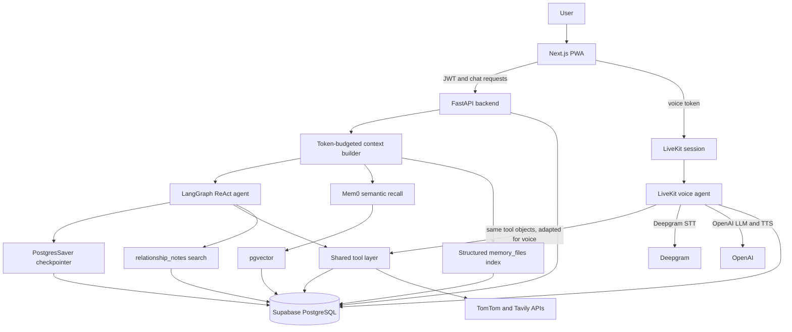

# JARVIS

JARVIS is a personal assistant with streaming text chat, LiveKit voice sessions, persistent conversations, user context, structured and semantic memory, and tools for people, goals, reminders, maps, and web search. The web client is a Next.js PWA, the API and text agent run in FastAPI and LangGraph, and Supabase PostgreSQL stores application and memory data. **Live demo:** [jarvis-eta-self.vercel.app](https://jarvis-eta-self.vercel.app)

## Architecture



Supabase Auth issues JWTs validated by the backend. The authenticated user ID is passed into agent state and used for user-scoped operations. The backend uses Supabase PostgreSQL for application records, memory data, and the LangGraph checkpoint store. There is no Redis dependency. The world-state cache is stored in Supabase. APScheduler runs background reminder and relationship jobs.

## Agent Design

The text agent is a LangGraph ReAct graph. Each conversation uses a `thread_id`; the PostgresSaver checkpointer stores graph state so messages can resume after a browser refresh or backend restart. The client sends the latest user turn, and LangGraph reloads prior messages for that thread.

The context builder assembles a default 6,000-token budget in priority order:

1. Base agent instructions, always included.
2. User profile.
3. World state, including local time, location, and available weather context.
4. Active goals.
5. Mem0 semantic recall and the structured memory-file index.
6. Conversation summary, when available. The builder's dedicated `conversation_summaries` lookup currently has no backing table, so this layer is empty. The API separately reads a saved summary from `conversations` for a new thread when available.

Recent messages are restored from the checkpoint and are not another context-builder layer. Optional lower-priority layers can be omitted when the token budget is exceeded.

Memory selection is not handled by a fixed keyword router. The context includes semantic results and a compact index of structured files; the agent decides whether to call a memory-file tool to read the relevant file. Relationship questions use the relationship-note search tool.

Text and voice use the same base instructions and underlying tool objects. The voice adapter wraps those tools for the LiveKit SDK. Their orchestration differs: text runs through LangGraph, while voice runs in a LiveKit AgentSession. Voice uses Deepgram for speech recognition and OpenAI for language generation and speech output.

## Memory System

- **Authoritative application data:** Supabase tables hold user, people, relationship-note, goal, reminder, conversation, and message records. Person-specific facts belong in `relationship_notes`.
- **Authoritative structured personal state:** `memory_files` stores durable categories such as identity, employment, location, projects, goals, and preferences. The agent reads files from an injected index. Updates preserve earlier values in the file history.
- **Derived and supporting memory:** Mem0 extracts and retrieves semantic memories backed by pgvector. It is not authoritative for changing current-state facts; Mem0 writes are currently add-only, so old and new values can coexist.
- **Conversation state:** LangGraph checkpoints support resuming a thread. Conversation and message records are also stored in Supabase.

An automatic memory-supersession layer was tried because Mem0's write path is add-only. In testing, the LLM-based deletion logic removed ten unrelated, still-valid memories. The deleted data was restored, and the lifecycle call was disabled. The module remains in the repository, but it is not part of the active memory-write path. This avoids destructive updates; it does not resolve conflicting Mem0 facts.

## Reliability and Testing

The repository currently contains no automated test files, and the frontend package has no test script. No automated test pass count is available because there is no configured suite to run.

Known issues recorded in the code and project docs:

- Google Calendar fetching is a stub and returns no calendar events.
- Mem0 supersession is disabled after incorrect deletions; conflicting facts may remain together.
- The context builder's `conversation_summaries` table lookup is not backed by a migration. The API has a separate summary path using the `conversations` table.
- Voice, web search, and maps require provider credentials; those integrations are not available when their credentials are absent.

## Tech Stack

- **Web:** Next.js 14, React 18, TypeScript, Tailwind CSS, service worker/PWA.
- **API and text agent:** Python, FastAPI, LangGraph, LangChain, OpenAI.
- **Voice:** LiveKit Agents SDK, Deepgram STT, OpenAI LLM and TTS, Silero VAD.
- **Data and authentication:** Supabase Auth, PostgreSQL, pgvector, PostgresSaver, Mem0.
- **Integrations:** TomTom maps and routing, Tavily web search, APScheduler.

## Roadmap

| Area | Status | Notes |
| --- | --- | --- |
| Streaming text chat and resumable conversations | Implemented | LangGraph with PostgresSaver. |
| LiveKit voice with shared tools | Implemented | Voice and text use the same tool objects and base instructions. |
| People, goals, reminders, maps, and web search | Implemented | Available through API routes and agent tools. |
| Google Calendar integration | In progress | The current calendar fetch function is a stub. |
| Safe Mem0 current-state supersession | In progress | Previous deletion logic was disabled after data loss; a safe replacement is not implemented. |
| Groq fallback routing | Planned | The dependency is present, but routing is not wired into the agent. |
| Email and document search | Proposed | Listed as ideas in `TOOLS.md`, not committed features. |

## Setup and Run Locally

Prerequisites: Python 3.12, Node.js, and a Supabase project. External integrations require their own provider credentials.

1. Create local environment files from the examples:

   ```bash
   cp .env.example .env
   cp frontend/.env.local.example frontend/.env.local
   ```

2. Configure backend values in `.env`, including `OPENAI_API_KEY`, `SUPABASE_URL`, `SUPABASE_ANON_KEY`, `SUPABASE_SERVICE_ROLE_KEY`, and `DATABASE_URL`. Set the frontend Supabase URL and anon key in `frontend/.env.local`, and set `NEXT_PUBLIC_JARVIS_URL` to `http://localhost:8000`.

3. Apply the SQL files in `backend/db/migrations/` to the Supabase project. The backend also initializes the LangGraph checkpoint tables at startup.

4. Install and start the backend from the repository root:

   ```bash
   pip install -r backend/requirements.txt
   uvicorn backend.main:app --reload --port 8000
   ```

5. In another terminal, install and start the frontend:

   ```bash
   cd frontend
   npm install
   npm run dev
   ```

   Open `http://localhost:3000`.

6. To run the optional voice worker, configure LiveKit and Deepgram credentials, then run `python -m backend.livekit_agent dev` from the repository root.

For deployment, adapt the scripts and configuration in [`deploy/`](deploy/) to your environment. Keep secrets in environment files or a secret manager, never in the repository.

## Open Question

Is `https://jarvis-eta-self.vercel.app` still the intended public live-demo URL? It is listed as an allowed frontend origin in the repository, but its current deployment status is not verifiable from the code.
